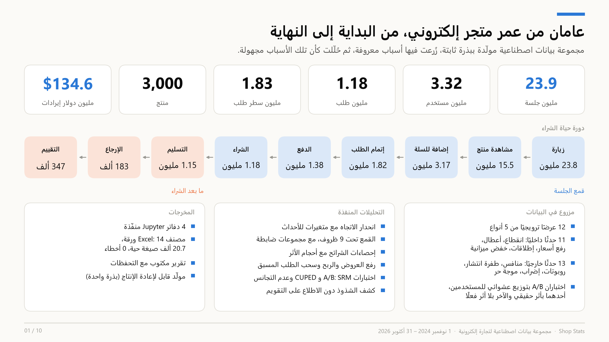
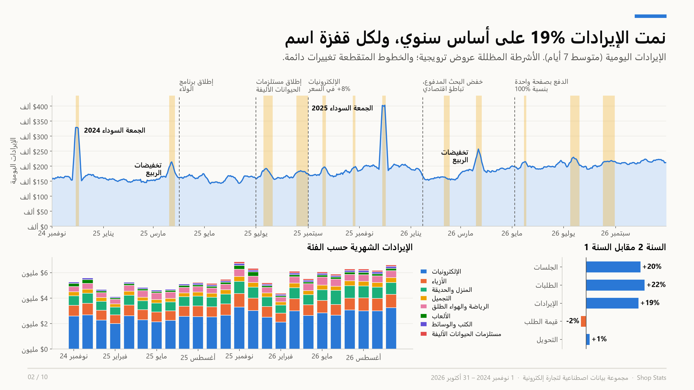
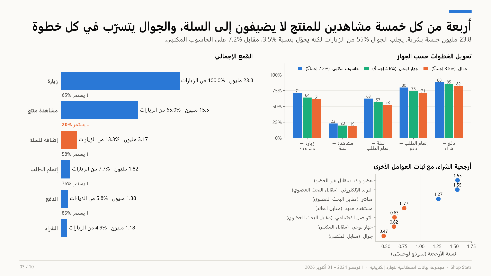
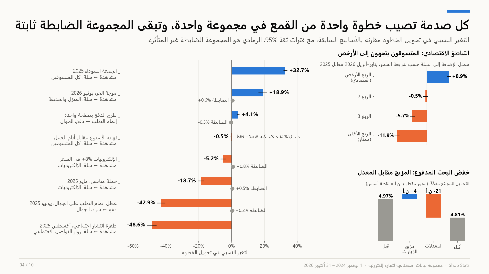
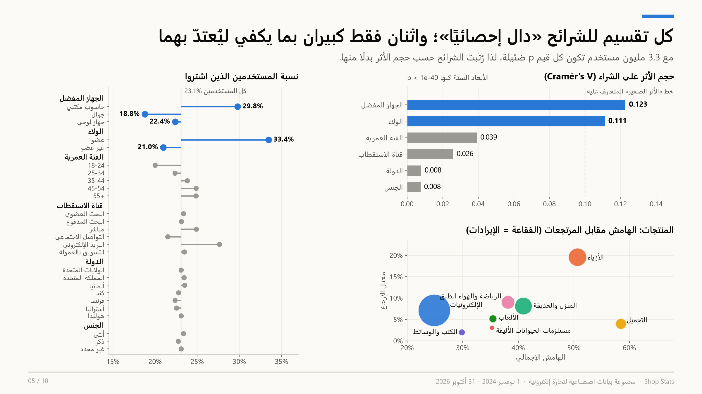
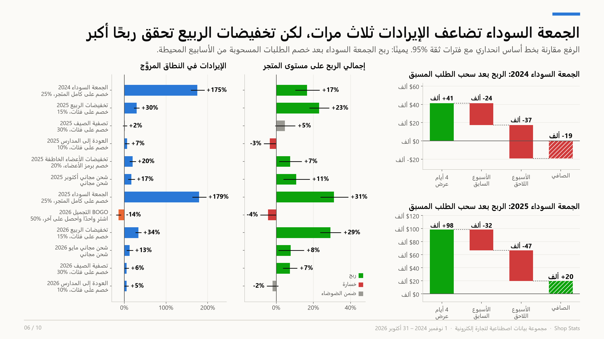
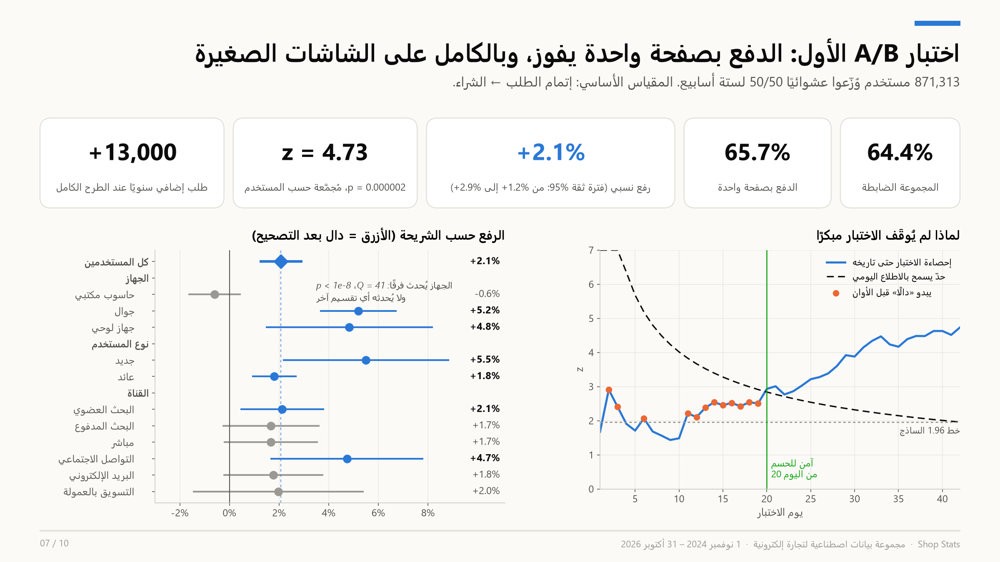
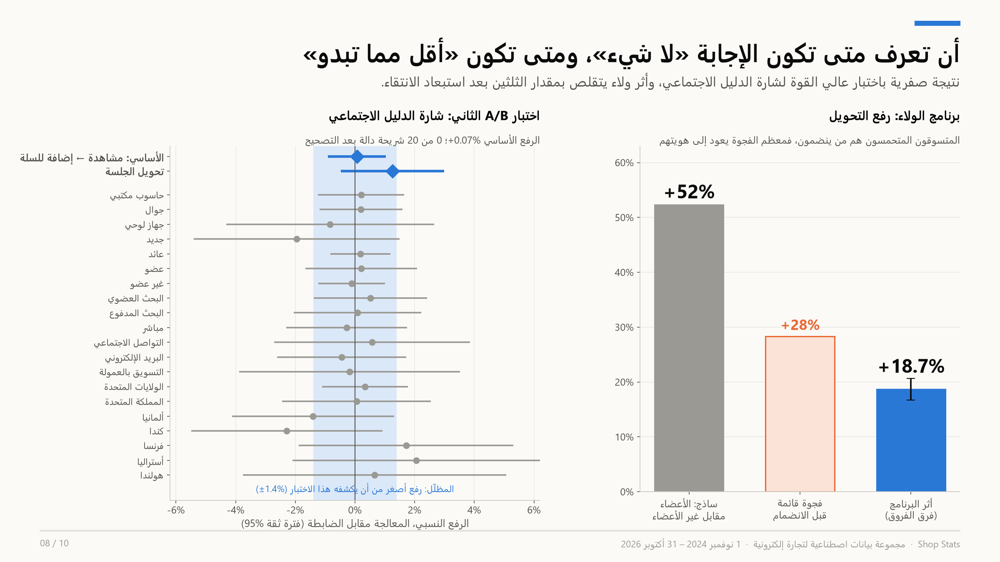
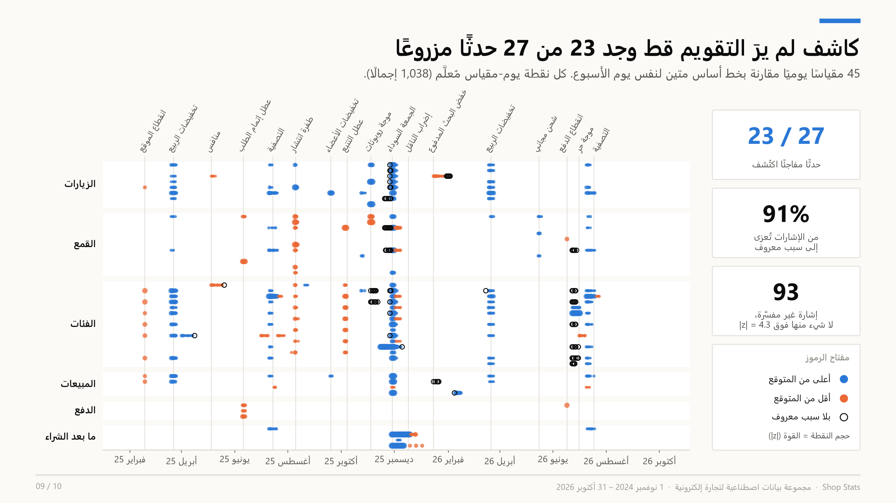
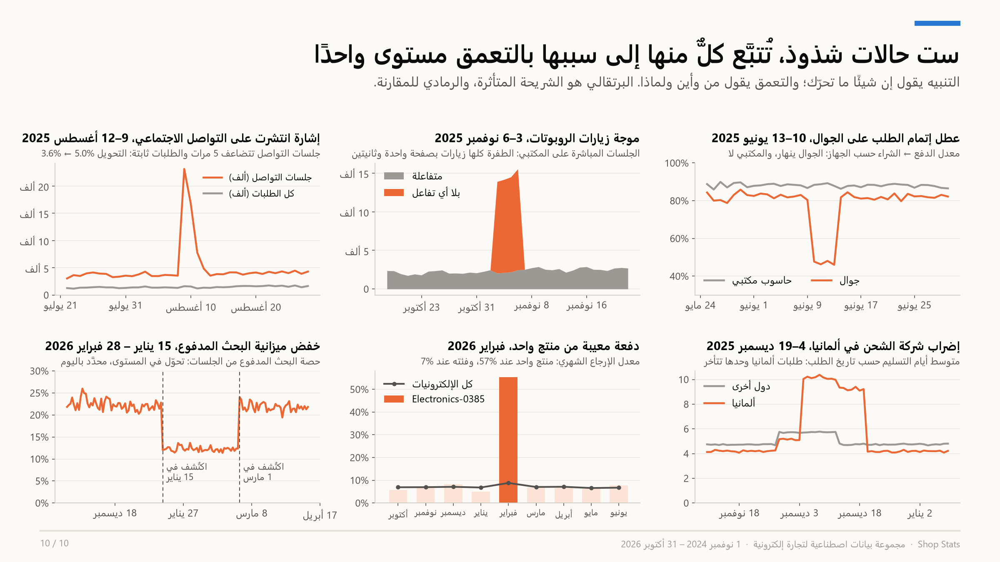

[English](README.md)

<div dir="rtl">

# Shop Stats

‏Shop Stats دراسة تحليلية شاملة لمتجر إلكتروني خيالي. يُنتج مولّد بيانات ذو بذرة ثابتة عامين من بيانات
المتجر زُرعت فيها أسباب معروفة: عروض ترويجية، وحوادث، وصدمات خارجية، واختبارا A/B. ثم يتعامل التحليل
مع هذه الأسباب كأنها مجهولة ويحاول استعادتها بتحليل القمع، وإحصاءات الشرائح، وتحليل التجارب، وكشف
الشذوذ. ولأن الحقيقة معروفة، يمكن تقييم كل طريقة بحسب ما إذا كانت قد وجدت ما كان موجودًا فعلًا.

جميع البيانات اصطناعية. والنتائج تصف المتجر المُحاكى، لا شركة حقيقية.



## ما الذي بُني

| | |
|---|---|
| **مجموعة البيانات** | ‏23.9 مليون جلسة، و3.32 مليون مستخدم، و1.18 مليون طلب، و1.83 مليون سطر طلب، و3,000 منتج خلال الفترة من 1 نوفمبر 2024 إلى 31 أكتوبر 2026، بإيرادات قدرها 134.6 مليون دولار. تتبّع البيانات كل زيارة عبر مشاهدة المنتج، والسلة، وإتمام الطلب، والدفع، والشراء، ثم التسليم، والمرتجعات، والتقييمات. |
| **الأسباب المزروعة** | ‏12 عرضًا ترويجيًا من خمسة أنواع، و11 حدثًا داخليًا (انقطاع، وعطلان، ورفع سعر، وإطلاقات، وخفض ميزانية)، و13 حدثًا خارجيًا (حملة منافس، وطفرة انتشار، وموجة روبوتات، وإضراب شركة شحن، وموجة حر، وموسمية)، واختبارا A/B بتوزيع عشوائي على مستوى المستخدم. |
| **الدفاتر** | أربعة دفاتر Jupyter منفّذة: الاتجاهات، والقمع والشرائح، والعروض الترويجية واختبارات A/B، وكشف الشذوذ. تعمل جميعها دون أخطاء. |
| **المصنف** | ‏`Shop_Stats_Analysis.xlsx`: ‏14 ورقة ونحو 20,700 صيغة حية تعيد حساب المعدلات والفترات والاختبارات من الأعداد، دون أي أخطاء في الصيغ. |
| **التقرير** | تقرير مكتوب يتضمن المنهجية والنتائج والتحفظات والتوصيات. |
| **الصور** | الصور العشر الملخِّصة في هذه الصفحة، يعيد بناءها `src/make_showcase.py` (بالإنجليزية) و`src/make_showcase_ar.py` (بالعربية). |

## أبرز الإنجازات

- **وجد كاشف الشذوذ 23 من أصل 27 حدثًا مفاجئًا مزروعًا دون أن يطّلع على التقويم.**
  من بين إشاراته البالغة 1,038 إشارة، تعود 91% إلى سبب معروف، ولا تتجاوز أيٌّ من الإشارات الـ93 غير
  المفسَّرة القيمة ‎|z| = 4.3. وحدّد مسح منفصل لتحولات المستوى تاريخ التغييرين الدائمين اللذين فاتاه بفارق أيام.
- **استعاد تحليل A/B الحقيقتين المزروعتين كلتيهما.** فقد وجد الأثر الحقيقي وموضعه (الشاشات الصغيرة)،
  وأبلغ عن النتيجة الصفرية الحقيقية بوصفها صفرية بدلًا من فوز زائف.
- **تقترن الدلالة الإحصائية بحجم الأثر في كل موضع.** مع ملايين الصفوف يصبح كل شيء تقريبًا «دالًا»، لذا
  تُرفق النتائج بفترات الثقة وأحجام الأثر وتصحيح الاختبارات المتعددة، وتستخدم مقارنات ما قبل/ما بعد مجموعة ضابطة.
- **المشروع كله قابل لإعادة الإنتاج** من بذرة واحدة باستخدام تثبيت Anaconda الموجود.

## أبرز النتائج

**النمو.** نمت الإيرادات 19% على أساس سنوي، مع زيادة الجلسات 20% والطلبات 22%. وتراجع متوسط قيمة
الطلب 2% وبقي التحويل ثابتًا.



**القمع.** لا يضيف إلى السلة سوى 20% ممن يشاهدون المنتج، وهذه أكبر خسارة منفردة. يجلب الجوال 55% من
الزيارات لكنه يحوّل بنسبة 3.5% مقابل 7.2% على الحاسوب المكتبي، وهو أضعف في كل خطوة. ومع ثبات العوامل
الأخرى، تبلغ أرجحية الشراء في جلسة الجوال 0.47 مرة من أرجحيتها في جلسة الحاسوب المكتبي.



**القمع تحت ظروف متغيرة.** تحرّك كل صدمة خطوة واحدة في مجموعة واحدة بينما تبقى مجموعتها الضابطة ثابتة.
خفّض عطل الدفع على الجوال معدل الانتقال من الدفع إلى الشراء بنسبة 43% على الجوال وحده. وخفّضت حملة
منافس معدل الإضافة إلى السلة في الإلكترونيات بنسبة 19%. وفي التباطؤ الاقتصادي اتجه المتسوقون إلى الأرخص:
ارتفع معدل الإضافة إلى السلة للمنتجات الاقتصادية 9% وانخفض للمنتجات الممتازة 12%.



**الشرائح.** تختلف أبعاد المستخدمين الستة كلها بقيمة p < 1e-40، لكن الجهاز المفضل وعضوية الولاء وحدهما
لهما أثر كبير بما يكفي للتصرف بناءً عليه. أما الدولة والجنس فأثرهما ضئيل. ومن بين المنتجات، تجمع الأزياء بين
هامش 51% ومعدل إرجاع 20%.



**العروض الترويجية.** ترفع الجمعة السوداء الإيرادات بنحو 175%، لكن بعد خصم الطلبات المسحوبة من الأسابيع
المحيطة بها كان الربح ‎−19 ألف دولار في 2024 و‎+20 ألف دولار في 2025. وتضيف تخفيضات الربيع أكبر ربح على
مستوى المتجر (‎+23% و‎+29%). أما العودة إلى المدارس وعرض «اشترِ واحدًا واحصل على آخر» للتجميل فيكلّفان ربحًا.



**اختبار A/B الأول: الدفع بصفحة واحدة.** ارتفع معدل الانتقال من إتمام الطلب إلى الشراء من 64.4% إلى 65.7%،
أي رفع نسبي قدره 2.1% (z = 4.73). ويبلغ المكسب ‎+5.2% على الجوال و‎+4.8% على الجهاز اللوحي، ولا شيء على
الحاسوب المكتبي. بدت النتيجة «دالة» في اثني عشر يومًا مبكرًا، لكن الحد الآمن من الاطلاع المتكرر لم يُتجاوز إلا في اليوم 20.



**اختبار A/B الثاني وبرنامج الولاء.** لم تُحدث شارة الدليل الاجتماعي أي أثر (‎+0.07%)، في اختبار كبير بما
يكفي لكشف رفع قدره 1.4%، ولا تظهر أي شريحة من الشرائح الـ20 دلالة بعد التصحيح. يحوّل أعضاء برنامج الولاء
أفضل من غير الأعضاء بنسبة 52%، لكن معظم هذه الفجوة كان قائمًا قبل انضمامهم؛ ولا يضيف البرنامج نفسه سوى نحو 19%.



**الشذوذ.** تتطابق إشارات الكاشف مع الانقطاع، والأعطال، وموجة الروبوتات، والإضراب، والعروض الترويجية.
ويكشف التعمق مستوى واحدًا عن السبب في كل مرة، وصولًا إلى منتج واحد بلغ معدل إرجاعه 57% في شهر واحد.





## الحدود

- تستند خطوط أساس العروض الترويجية إلى عامين من البيانات، فلكل عرض موسمي حدوثان فقط. وهذه التقديرات
  هي الأضعف في المشروع.
- فات الكاشفَ أثران موسميان صغيران، وهو بحكم تصميمه لا يلتقط التغيرات التدريجية؛ فتلك تحتاج إلى مسح
  تحولات المستوى.
- الربح هنا هو الربح الإجمالي. ولم تُنمذج تكاليف التسويق والتنفيذ.

## الملفات

| المسار | المحتوى |
|---|---|
| `showcase/` | الصور العشر بالإنجليزية (PNG بأبعاد 2400 × 1350) |
| `showcase_ar/` | الصور العشر نفسها بالعربية (المعروضة أعلاه) |
| `notebooks/` | الدفاتر الأربعة المنفّذة |
| `Shop_Stats_Analysis.xlsx` | مصنف Excel |
| `data/` | الجداول المولّدة (Parquet وCSV) وتقاويم الأحداث والعروض الترويجية والاختبارات. الملف `sessions.parquet` (470 ميغابايت) ليس في المستودع؛ أعد بناءه بالأمر `python src/generate_data.py` |
| `outputs/` | التجميعات والأشكال التي صدّرتها الدفاتر |
| `src/` | ‏`generate_data.py` و`build_notebooks.py` و`build_excel.py` و`make_showcase.py` و`make_showcase_ar.py` و`translate_report_ar.py` (التقرير العربي) والدوال المساعدة المشتركة |
| `Shop Stats Store Analytics Report - Arabic.docx` | الترجمة العربية للتقرير المكتوب |

لإعادة بناء الصور الإنجليزية ثم العربية:

</div>

```powershell
C:\Users\keep_\anaconda3\python.exe src\make_showcase.py
C:\Users\keep_\anaconda3\python.exe src\make_showcase_ar.py
```

<div dir="rtl">

يتطلب السكربت العربي الحزمتين `arabic_reshaper` و`python-bidi` (مثبّتتان في Anaconda). في matplotlib 3.11
وما بعده يتولى matplotlib تشكيل النص العربي واتجاهه بنفسه، فيمرّر السكربت النص كما هو؛ أما في الإصدارات
الأقدم فيستخدم الحزمتين لتشكيله.

</div>
