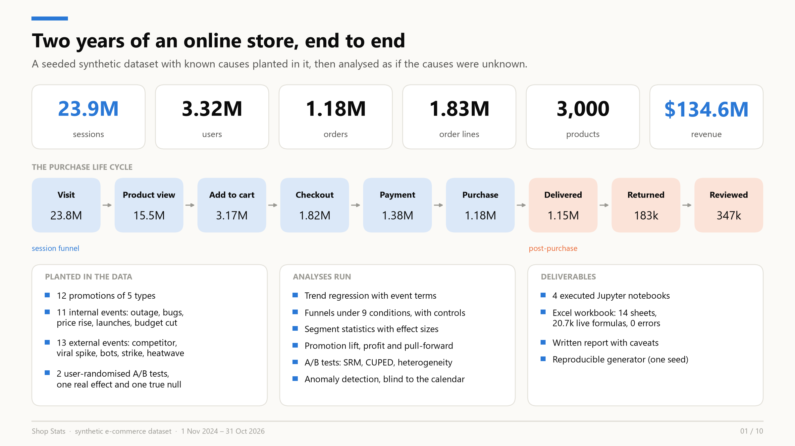
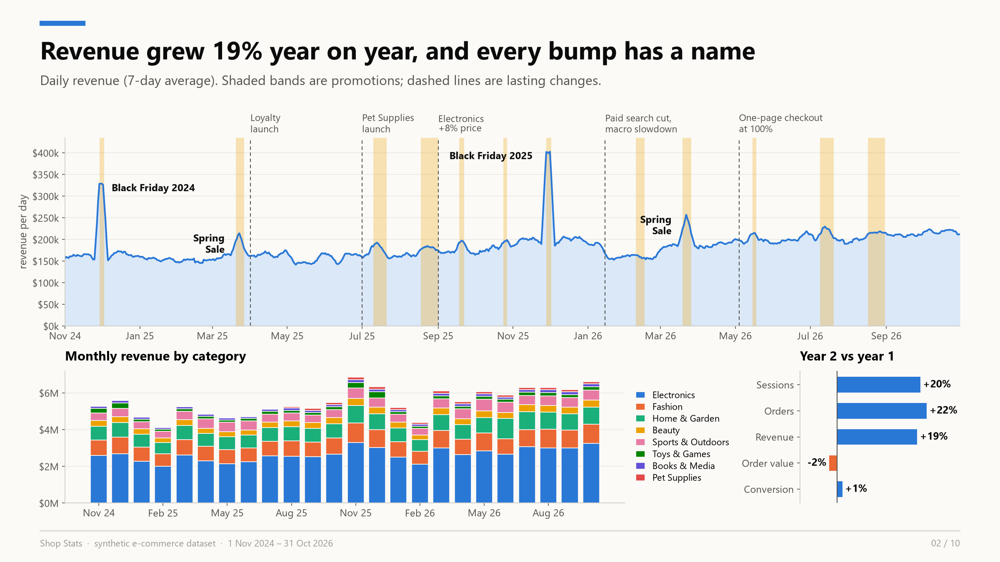
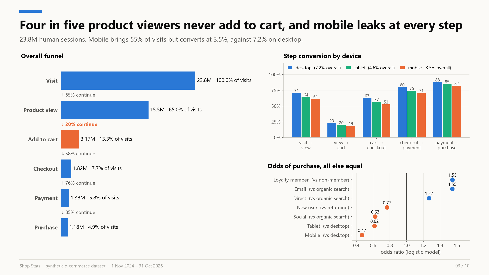
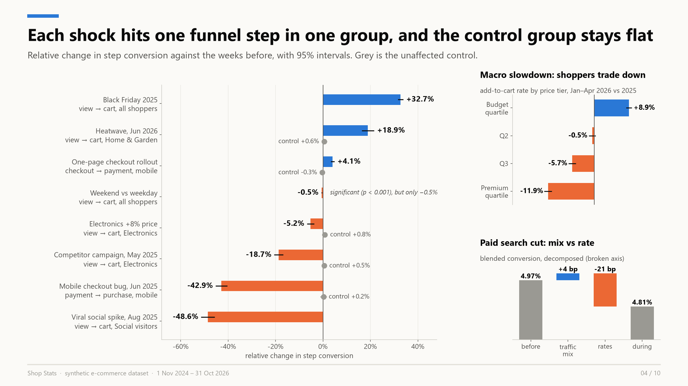
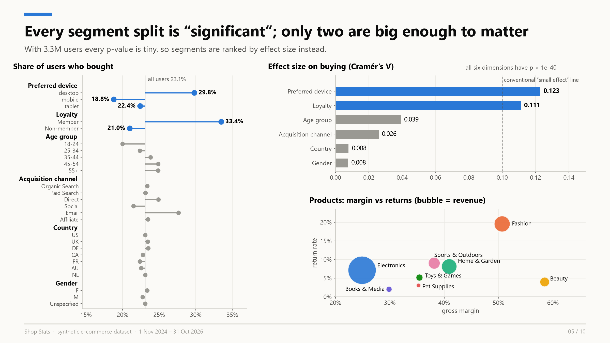
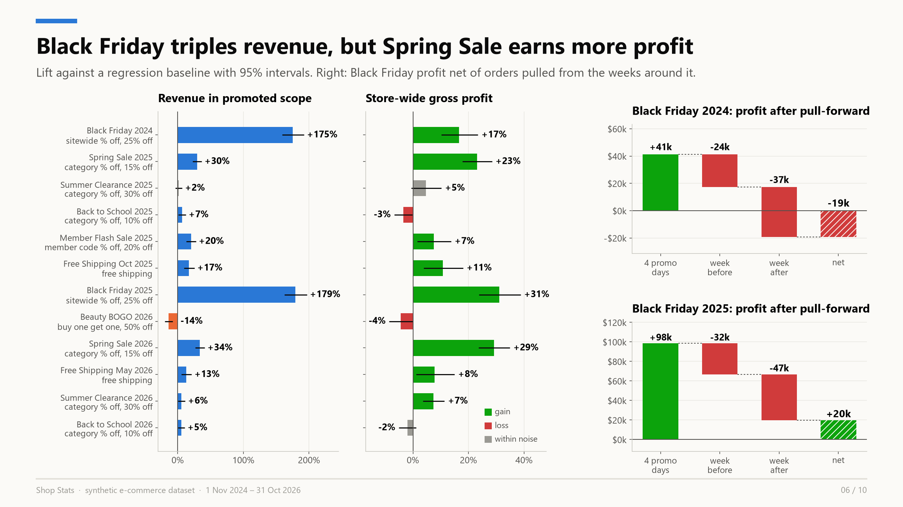
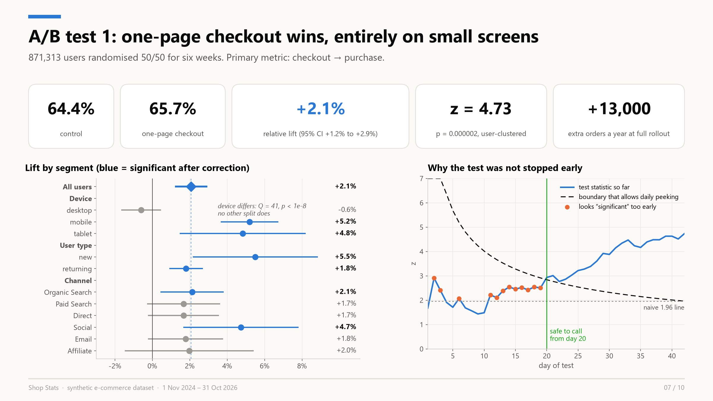
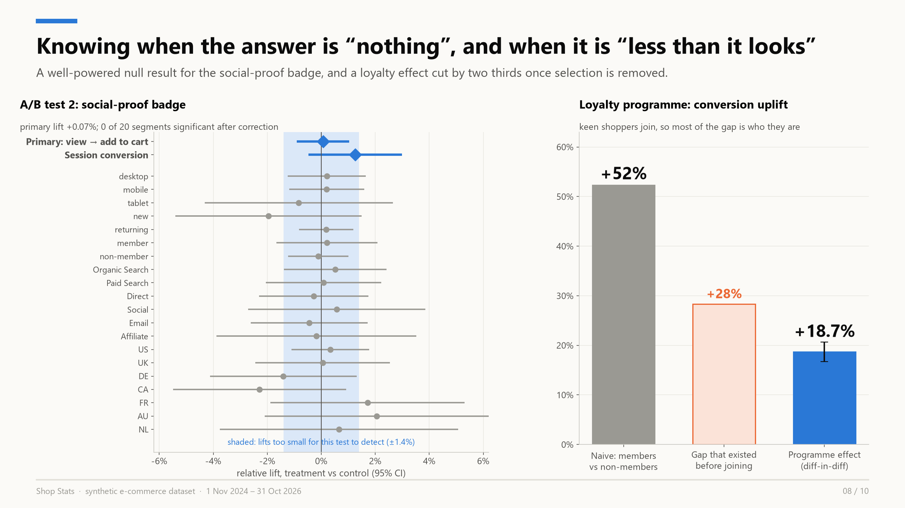
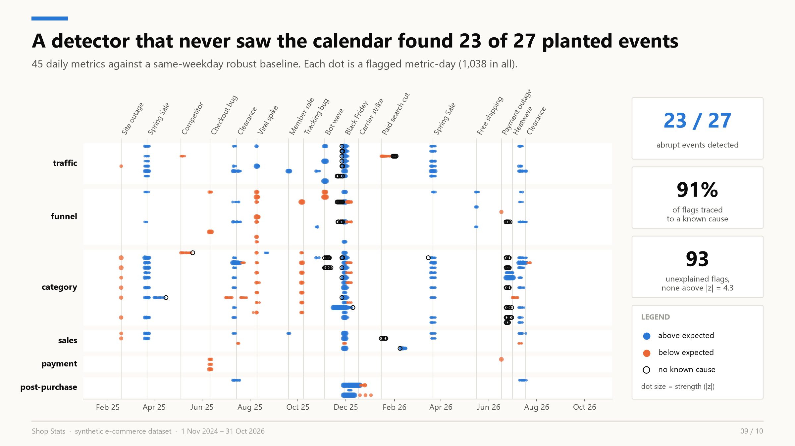
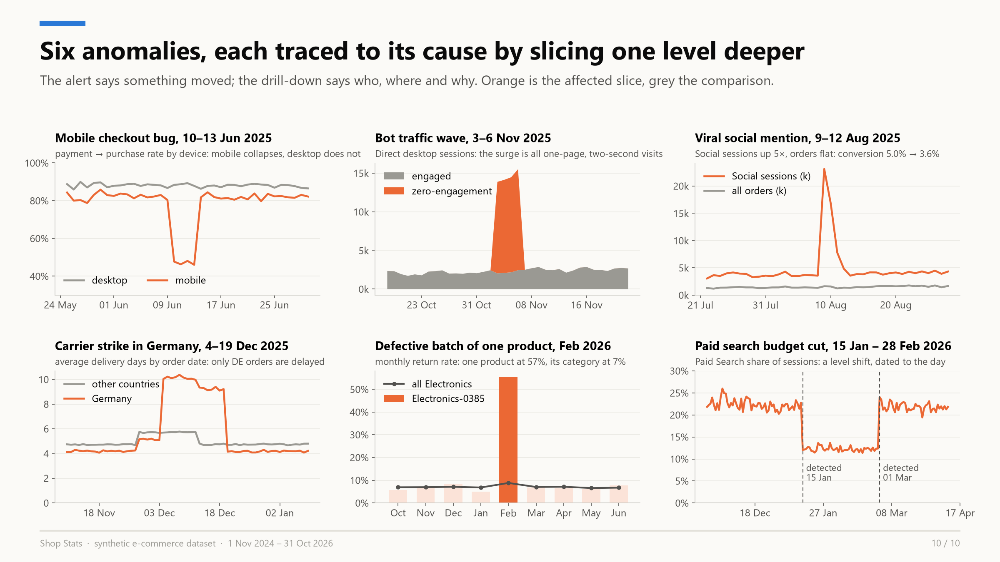

[العربية](README.ar.md)

# Shop Stats

Shop Stats is an end-to-end analytics study of a fictional online store. A seeded generator
produces two years of store data with known causes planted in it: promotions, incidents, outside
shocks and two A/B tests. The analysis then treats those causes as unknown and tries to recover
them with funnel analysis, segment statistics, experiment analysis and anomaly detection. Because
the truth is known, every method can be scored on whether it found what was really there.

All data is synthetic. The findings describe the simulated store, not a real business.



## What was built

| | |
|---|---|
| **Dataset** | 23.9M sessions, 3.32M users, 1.18M orders, 1.83M order lines and 3,000 products over 1 Nov 2024 – 31 Oct 2026, with $134.6M revenue. It follows each visit through product view, cart, checkout, payment and purchase, then delivery, returns and reviews. |
| **Planted causes** | 12 promotions of five types, 11 internal events (outage, two bugs, a price rise, launches, a budget cut), 13 external events (competitor campaign, viral spike, bot wave, carrier strike, heatwave, seasonality) and 2 user-randomised A/B tests. |
| **Notebooks** | Four executed Jupyter notebooks: trends, funnel and segments, promotions and A/B tests, anomaly detection. All run with no errors. |
| **Workbook** | `Shop_Stats_Analysis.xlsx`: 14 sheets and about 20,700 live formulas that recompute the rates, intervals and tests from counts, with no formula errors. |
| **Report** | A written report with the method, results, caveats and recommendations. |
| **Images** | The ten summary images on this page, rebuilt by `src/make_showcase.py`. |

## Main achievements

- **The anomaly detector found 23 of the 27 abrupt planted events without seeing the calendar.**
  Of its 1,038 flags, 91% trace to a known cause, and none of the 93 unexplained flags exceeds
  |z| = 4.3. A separate level-shift scan dated the two permanent changes it missed to within days.
- **The A/B analysis recovered both planted truths.** It found the real effect and where it
  lives (small screens), and it reported the true null as a null instead of a false win.
- **Significance is paired with effect size throughout.** With millions of rows almost
  everything is "significant", so results carry intervals, effect sizes and
  multiple-testing correction, and before/after comparisons use a control group.
- **The whole project is reproducible** from one seed with the existing Anaconda install.

## Main findings

**Growth.** Revenue grew 19% year on year, on 20% more sessions and 22% more orders. Average
order value slipped 2% and conversion was flat.



**Funnel.** Only 20% of product viewers add to cart, which is the largest single loss. Mobile
brings 55% of visits but converts at 3.5%, against 7.2% on desktop, and it is weaker at every
step. All else equal, a mobile session has 0.47 times the odds of purchase of a desktop one.



**Funnel under conditions.** Each shock moves one step in one group while its control stays
flat. The mobile checkout bug cut payment-to-purchase by 43% on mobile only. A competitor
campaign cut Electronics add-to-cart by 19%. In the macro slowdown, shoppers traded down:
budget products gained 9% in add-to-cart rate and premium products lost 12%.



**Segments.** All six user dimensions differ with p < 1e-40, but only preferred device and
loyalty membership have an effect large enough to act on. Country and gender are negligible.
Among products, Fashion pairs a 51% margin with a 20% return rate.



**Promotions.** Black Friday lifts revenue by about 175%, but after netting off orders pulled
from the weeks around it, profit was −$19k in 2024 and +$20k in 2025. The Spring Sale adds
the most store-wide profit (+23% and +29%). Back to School and the Beauty buy-one-get-one
cost profit.



**A/B test 1, one-page checkout.** Checkout-to-purchase rose from 64.4% to 65.7%, a 2.1%
relative lift (z = 4.73). The gain is +5.2% on mobile and +4.8% on tablet, with nothing on
desktop. The result looked "significant" on twelve early days, but the peeking-safe boundary
was only crossed on day 20.



**A/B test 2 and the loyalty programme.** The social-proof badge did nothing (+0.07%), in a
test large enough to detect a 1.4% lift, and none of 20 segments is significant after
correction. Loyalty members convert 52% better than non-members, but most of that gap
existed before they joined; the programme itself adds about 19%.



**Anomalies.** The detector's flags line up with the outage, the bugs, the bot wave, the
strike and the promotions. Slicing one level deeper names the cause each time, down to a
single product whose return rate hit 57% in one month.





## Limits

- The promotion baselines rest on two years of data, so each seasonal promotion has only two
  occurrences. Those estimates are the weakest in the project.
- The detector missed two small seasonal effects and, by design, does not catch gradual
  changes; those need the level-shift scan.
- Profit here is gross profit. Marketing and fulfilment costs are not modelled.

## Files

| Path | Contents |
|---|---|
| `showcase/` | The ten images above (2400 × 1350 PNG) |
| `notebooks/` | The four executed notebooks |
| `Shop_Stats_Analysis.xlsx` | The Excel workbook |
| `data/` | Generated tables (Parquet and CSV) and the event, promotion and test calendars. `sessions.parquet` (470 MB) is not in the repository; rebuild it with `python src/generate_data.py` |
| `outputs/` | Aggregates and figures exported by the notebooks |
| `src/` | `generate_data.py`, `build_notebooks.py`, `build_excel.py`, `make_showcase.py`, `make_showcase_ar.py`, `translate_report_ar.py` (Arabic report), shared helpers |

To rebuild the images:

```powershell
C:\Users\keep_\anaconda3\python.exe src\make_showcase.py
```
